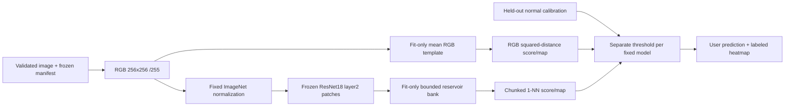

# Edge Inspect

Visual anomaly detection and hardware-aware inference for an AI/ML engineering portfolio. The intended product detects visual defects in one object category, produces anomaly scores and heatmaps, compares a simple distance baseline with a pretrained-feature detector, and measures inference speed and memory on actual hardware.

**Owner:** Thilanka Thushan  
**Status:** Foundation, data pipeline, classical baseline, and CPU PatchCore-style detector implemented and tested with synthetic fixtures; official data acquisition is pending. Both detectors train, calibrate, predict, and support a frozen evaluation pipeline. The evaluator is verified on synthetic fixtures; the local demo is implemented; real held-out evaluation remains pending.

The current package provides strict TOML configuration, a validated image/mask inventory, hashed manifests, deterministic fit/calibration splits and preprocessing, JSON logging, and a tested CLI. See [IMPLEMENTATION_PLAN.md](IMPLEMENTATION_PLAN.md) for milestones and [PROGRESS.md](PROGRESS.md) for verification history.


**Release candidate, not production-validated.** [Model card](docs/MODEL_CARD.md) · [Case study](docs/CASE_STUDY.md) · [Release checklist](docs/RELEASE.md) · [Attribution](docs/ATTRIBUTION.md) · [CPU deployment](docs/DEPLOYMENT.md) · [Recording script](docs/DEMO_SCRIPT.md)

### Evidence at a glance

| Evidence | Status |
|---|---|
| Real MVTec defect quality | Pending: dataset not acquired |
| Local demo | Browser-verified with actual saved fixture artifacts |
| CPU optimization, Apple M2 | Original p50/p95 270.1/275.5 ms; ONNX path 287.2/289.5 ms |
| Process peak RSS, same workload | Original 377.5 MiB; ONNX path 349.4 MiB |
| Numerical/decision parity | Passed on 26 fixtures; zero changed decisions |
| Camera / other edge hardware | No experiments performed |

Runtime numbers are warm CPU measurements on **synthetic calibration fixtures**, not MVTec quality results. RSS is whole-worker memory including startup. [Full methodology and results](docs/ONNX_RESULTS.md). ONNX was slower; original inference stays the default. No evaluation results were rerun for release documentation.

### Fastest offline demo path

After the setup below, generate a small fixture-trained baseline (no dataset or weights download):

```sh
.venv/bin/python -m pip install -e '.[dev,demo]'
.venv/bin/python scripts/verify_fixture_baseline.py --name portfolio-demo
.venv/bin/streamlit run app.py --server.address 127.0.0.1
```

Open http://127.0.0.1:8501, select the saved baseline and labeled synthetic sample. Use an unused fixture name on repeat runs. For the learned path, install the features extra and explicitly acquire weights as documented below. No models are bundled with source. Original source is MIT licensed; pretrained-weight redistribution rights remain unresolved; see the release checklist.

## Setup

Run from this project folder. No system-wide packages are required:

```sh
cd 02-edge-inspection
python3 -m venv .venv
.venv/bin/python -m pip install -e '.[dev]'
.venv/bin/edge-inspect check-config --config configs/default.toml
.venv/bin/python -m pytest -q
```

Python 3.11–3.14 is declared compatible; this foundation is tested on Python 3.14.0. The `src/edge_inspect` package uses the standard library for CLI, configuration, and logging; Pillow validates image decoding, NumPy supplies float32 tensors, and pytest supplies development tests. The baseline needs no deep-learning framework. The optional feature detector uses project-local PyTorch/torchvision and explicitly fetched ResNet18 weights. Dependency ranges live in `pyproject.toml`; `requirements-dev.lock.txt` records the resolved development environment. To reproduce its dependency versions before installing the local package:

```sh
.venv/bin/python -m pip install -r requirements-dev.lock.txt
.venv/bin/python -m pip install --no-deps -e .
```

The lock records dependency versions, not cross-platform binary hashes or the isolated build backend. Packaging follows [PyPA's pyproject guidance](https://packaging.python.org/en/latest/guides/writing-pyproject-toml/). Dependency choices were checked against [Pillow's Python support table](https://pillow.readthedocs.io/en/stable/installation/python-support.html) and [pytest's official getting-started guide](https://docs.pytest.org/en/stable/getting-started.html).

## Configuration and commands

Edit `configs/default.toml`. Relative paths resolve against the configuration file's directory, regardless of your shell's working directory. Absolute paths and `~` are supported. Unknown keys, unsafe category names, invalid seeds, overlapping data/artifact directories, and unsupported devices are rejected. Configuration validation does not require a dataset and does not create directories.

- `data_root`: directory containing category folders.
- `category`: `bottle` from original MVTec AD; the versioned protocol supports only this category.
- `seed`: integer in `[0, 4294967295]`; default 42. Used in the stable hash ordering for the normal fit/calibration split.
- `artifact_root`: destination reserved for generated outputs, separate from data.
- `device`: `cpu`; the classical baseline uses NumPy CPU execution.

```sh
.venv/bin/edge-inspect --help
.venv/bin/edge-inspect check-config --config configs/default.toml
# Once official bottle data has been acquired through the form:
.venv/bin/edge-inspect inspect-data --config configs/default.toml
.venv/bin/edge-inspect prepare-data --config configs/default.toml
```

`python -m edge_inspect` is an equivalent entry point inside the environment. Each subcommand requires `--config`. Successful results are JSON on stdout; operational logs are JSON on stderr. Exit code 0 indicates success; 2 indicates an input/configuration error or an unimplemented command. Argument-parser usage errors use conventional argparse text.

`train` fits the classical baseline; `train-features` fits the PatchCore-style memory bank; `predict` dispatches by artifact type and saves scores, maps, and an overlay. `evaluate` compares frozen artifacts and writes metrics, plots, overlays and a report; see the evaluation commands below. See [baseline commands, artifacts, and limitations](docs/BASELINE.md).

Inspection expects an MVTec-style layout:

```text
data/mvtec_ad/bottle/
  train/good/*.png
  test/good/*.png
  test/<defect>/*.png
  ground_truth/<defect>/*_mask.png
```

Inspection verifies single-frame image decoding, mask pairing/dimensions/binary values, and normal-only training, and rejects corrupt inputs, orphan masks, ambiguous names, symlinks, and duplicate image bytes. It reports metadata only. Non-image files are counted as ignored. Manifest preparation also requires at least two training images and test normals plus masked anomalies; it does not certify official archive completeness or authenticity.

`prepare-data` writes a deterministic JSON snapshot under `artifacts/manifests/bottle-<sha256>.json` only after validation succeeds. It records each image's SHA-256, category, official split, label, anomaly flag, original dimensions, paired mask path/hash, and assigned role. Paths are relative to `data_root`; source/license, library versions, seed, and protocol are included. Preserve the snapshot and digest with each experiment. Raw files are never modified.

The prespecified split assigns `ceil(20% × N)` official normal training images to `normal_calibration`, with all remaining training images in `model_fit`. Stable SHA-256 ordering uses seed 42 and category-relative paths. All official test images retain `final_test`. The streaming Python API `edge_inspect.preprocessing.iter_samples(manifest, data_root, role)` verifies hashes before loading and rejects test loading unless `allow_final_test=True` is explicitly supplied for final evaluation. It rejects inconsistent split/role assignments and protocol changes; this is a software guard, not an access-control sandbox.

Preprocessing produces RGB float32 CHW tensors at 256×256 with bilinear direct resize and division by 255; optional pretrained normalization uses fixed ImageNet mean/std. Masks use nearest-neighbor resizing to boolean HW. No random augmentations or learned preprocessing statistics are used. Original masks remain available for final evaluation.

See [the frozen bottle protocol](docs/DATA_PROTOCOL.md) for the initial mean-template baseline and ResNet-18 feature-detector choices, exact transformations, test boundary, and **5% target FPR** normal-calibration rule. The threshold helper uses a conservative finite-sample order statistic and returns infinity when calibration is too small. A target FPR is not a measured result; a small calibration sample and domain shift limit what can be claimed.

## Classical baseline: train and predict

The prespecified mean-RGB template uses per-pixel color descriptors: fit the mean only on `model_fit`, compute mean squared channel residuals as an anomaly map, and use the maximum as the image score. Select the operating threshold only from held-out normal-calibration scores. No deep learning or learned preprocessing is involved.

After acquiring official data and running `prepare-data`, substitute its exact manifest path:

```sh
.venv/bin/edge-inspect train --config configs/default.toml \
  --manifest "artifacts/manifests/bottle-<sha256>.json" \
  --run-name baseline-v1 --data-kind official_mvtec_ad
.venv/bin/edge-inspect predict --config configs/default.toml \
  --model artifacts/models/baseline-v1 \
  --image /absolute/path/to/your-image.png --output-name example-01
```

Training saves `template.npy` and provenance/calibration metadata. Prediction saves a JSON score/decision, raw 256×256 and original-size maps, and a clearly labeled residual overlay. It rejects corrupt/unsupported images, invalid dimensions, and known reserved-test inputs. Insufficient calibration is reported as uncalibrated, not normal. Existing output directories are never overwritten.

You can verify the full path now without real data:

```sh
.venv/bin/python scripts/verify_fixture_baseline.py --name my-fixture-check
```

This generates **synthetic software fixtures only**, under ignored artifacts. It provides no real defect-detection benchmark. Read [BASELINE.md](docs/BASELINE.md) for the exact method, threshold, artifact format, and limitations. The baseline is alignment/lighting-sensitive and can miss subtle texture defects.

## PatchCore-style detector and architecture

The compact feature branch uses frozen ResNet18 `IMAGENET1K_V1`, layer2 patch embeddings, a seeded 4096-entry reservoir bank built only from model-fit normals, and chunked Euclidean nearest-neighbor scoring. Calibration images never enter the bank. The bank array is capped at 2 MiB; this is not a total-process memory measurement. The same normal-only 5% target-FPR threshold rule is used for both detectors.



This is **PatchCore-style**, with a smaller single-layer backbone and uniform reservoir sampling rather than the original method's coreset. [Method, sources, bounds, and limitations](docs/PATCHCORE_STYLE.md) document the differences. [Frozen comparison settings](configs/frozen_comparison.json) retain the baseline configuration and explicitly amend the earlier all-patch proposal for bounded CPU memory. No official test performance was used to select settings. Real artifact digests and thresholds remain to be frozen after real training and before evaluation.

Install the optional feature environment and fetch weights explicitly:

```sh
.venv/bin/python -m pip install -e '.[dev,features]'
.venv/bin/edge-inspect fetch-weights --config configs/default.toml
```

`fetch-weights` downloads approximately 45 MB from the official PyTorch model host into `artifacts/weights`, verifies its published hash prefix, and records the full SHA-256/source. Training and prediction never download. The code license is BSD-3-Clause, but **a separate weight-specific license was not verified**; upstream warns that pretrained models may have dataset-derived terms. Do not infer unrestricted commercial or redistribution rights from the code license. See [the source/license record](docs/PATCHCORE_STYLE.md#weight-license-status).

Once a real manifest is available:

```sh
.venv/bin/edge-inspect train-features --config configs/default.toml \
  --manifest "artifacts/manifests/bottle-<sha256>.json" \
  --weights artifacts/weights/resnet18-f37072fd.pth \
  --run-name patchcore-style-v1 --data-kind official_mvtec_ad
.venv/bin/edge-inspect predict --config configs/default.toml \
  --model artifacts/models/patchcore-style-v1 \
  --image /absolute/path/to/user-image.png --output-name feature-example-01
```

The saved model includes memory bank, pruned extractor state, preprocessing/layers/sampling configuration, bank provenance, calibration evidence, and hashes. Predictions share the baseline's input validation and official-test guards. The image score uses the raw patch-distance maximum; the resized heatmap is not a probability. `requirements-features.lock.txt` records the tested feature environment; the smaller baseline lock remains available.

## Hardware and execution policy

Observed on 2026-10-21: MacBook Air, Apple M2, 8 CPU cores (4 performance + 4 efficiency), 16 GB unified memory, 8-core Metal-capable GPU, arm64, macOS 27.0.1, Python 3.14.0. These are hardware observations, not inference benchmarks.

CPU is the supported execution target for both detectors. PyTorch 2.13.0 and torchvision 0.28.0 are installed in the optional feature environment. MPS execution is not enabled or verified. A future acceleration milestone must check `torch.backends.mps.is_available()`, then test the actual model's operations before enabling it; see the [official PyTorch MPS guidance](https://docs.pytorch.org/docs/stable/notes/mps.html). ONNX Runtime now supports the fixed CPU feature extractor; preprocessing and torch nearest-neighbor scoring remain external. OpenCV remains deferred.

## Data, artifacts, and limitations

The [official original MVTec AD source](https://www.mvtec.com/research-teaching/datasets/mvtec-ad) publishes the dataset under [CC BY-NC-SA 4.0](https://creativecommons.org/licenses/by-nc-sa/4.0/): non-commercial use, attribution, and ShareAlike conditions apply. Redistribution is conditional. Details and an attribution template are in [DATA_PROTOCOL.md](docs/DATA_PROTOCOL.md).

As checked on 2026-10-21, the official download flow requires a first/last name, email, and acknowledgment of non-commercial use. That form has not been submitted. Bottle-only availability, the current archive URL/size, and any further download terms remain unverified behind the form. No full archive or mirror has been downloaded. Complete the official form, obtain the bottle-only link if offered, and confirm any full-archive requirement before proceeding. Place the unmodified category under `data/mvtec_ad/bottle` (or change `data_root`), then run `prepare-data` above.

No real MVTec dataset has been downloaded. Official ResNet18 pretrained weights were explicitly fetched into ignored artifacts; see the weight-license limitations above. No real-data quality or localization benchmarks have been run. CPU runtime latency and process RSS have now been measured on explicitly labeled synthetic fixtures; see the ONNX results below. Tests use small synthetic software fixtures, not anomaly-detection benchmark data. Baseline training/calibration/prediction were also run end-to-end on a labeled fixture dataset. Both model implementations are verified on synthetic fixtures, including the real pretrained ResNet18 backbone. Real-data training/calibration, official evaluation/comparison, real-data hardware benchmarks remain pending. Project-local Git rules exclude datasets, environments, models, archives, and generated artifacts; keep external data and outputs outside Git too.

## Frozen final evaluation

**Official bottle data is not yet available (confirmed 2026-10-22). No real results are claimed.** Read [the evaluation protocol and limitations](docs/EVALUATION.md) before running. The evaluator records configurations, manifest/model hashes, thresholds and hardware before test inference. It rejects fixture models in official mode and records official attempts; later runs require `--exploratory` and must be disclosed.

Install project-local plotting support (the complete tested environment is in `requirements-evaluation.lock.txt`):

```sh
.venv/bin/python -m pip install -e '.[dev,features,evaluation]'
.venv/bin/python -m pytest -q
# Optional reproducible SOFTWARE FIXTURE verification; requires explicitly fetched weights.
# Use an unused output name; this does not download data or weights.
.venv/bin/python scripts/verify_fixture_evaluation.py --name my-evaluation-check
```

After official acquisition, manifest preparation and both real training/calibration runs above, substitute the exact manifest path:

```sh
.venv/bin/edge-inspect evaluate --config configs/default.toml \
  --manifest "artifacts/manifests/bottle-<sha256>.json" \
  --baseline artifacts/models/baseline-v1 \
  --features artifacts/models/patchcore-style-v1 \
  --comparison configs/frozen_comparison.json \
  --run-name frozen-bottle-v1
```

Outputs under `artifacts/evaluations/frozen-bottle-v1` include `prerun_snapshot.json`, manifest, status, `results.json`, per-image JSONL, maps, comparison/score plots, deterministic success/failure overlays and `REPORT.md`. Image AUROC, confusion counts, recall/FPR, per-defect metrics and warm CPU timings are recorded. **Pixel AUROC is an equal-image macro average of within-image AUROC at original resolution, not pooled pixel AUROC.** Undefined values are null with reasons. No finite threshold means no operating decisions. Latency excludes loading, hashing, mask/metric/report work; full measurement boundaries are in the snapshot and protocol. Memory benchmarking remains pending.

The completed local software-only report is at `artifacts/fixture-evaluation-verified/outputs/evaluations/comparison/REPORT.md`. All its figures and timings are synthetic-fixture verification, not MVTec performance. Real model comparison, missed-defect analysis and false-positive analysis remain pending. Keep test-informed changes separate as exploratory; do not tune and describe a repeated test run as untouched.

## ONNX extractor inference and measurements

`export-onnx` exports **only ResNet18 through layer2**, FP32 opset 18 with fixed normalized NCHW input `[1,3,256,256]` and output `[1,128,32,32]`. Pillow/NumPy preprocessing and normalization, patch layout, the original torch nearest-neighbor scorer, map interpolation and saved threshold remain outside ONNX. `predict --onnx <export-directory>` uses that bound extractor with the unchanged model bank/threshold. This is not a complete ONNX detector.

[ONNX setup, export, prediction and benchmark commands](docs/ONNX.md) document the exact boundaries. The project-local extra is `.[dev,features,evaluation,onnx]`; `requirements-onnx.lock.txt` records the tested environment.

`benchmark-onnx` measures normal calibration images by default, with five fit-normal warmups, repeated measurements, component/end-to-end p50/p95 latency, and fresh-process RSS/high-water memory for each runtime. It saves embedding/score/map parity, exact decision changes, hardware, versions, threads, provider and raw samples. The threshold is never adjusted to force agreement. An optional completed frozen evaluation enables an explicitly exploratory comparison on already-exposed test inputs.

**Observed on this Apple M2 Mac: ONNX was slower on the calibration-fixture workload, despite lower process peak RSS.** [Measured results and limitations](docs/ONNX_RESULTS.md) separate software-fixture quality from real defect detection. Real MVTec data is still absent; no Raspberry Pi, other edge-device, GPU or quantization results are claimed.

## Local interactive demo

```sh
cd 02-edge-inspection
.venv/bin/python -m pip install -e '.[dev,features,demo]'
.venv/bin/streamlit run app.py --server.address 127.0.0.1
```

Open http://127.0.0.1:8501. Stop with Ctrl-C. Local configuration binds loopback, disables usage telemetry, and caps uploads at 10 MiB. No cloud deployment or camera capture is implemented. Models are discovered beneath `artifacts/**/models/*`; select a saved baseline or PatchCore-style artifact. On a fresh checkout, first train a model using the commands above, or generate the clearly labeled fixture baseline with `scripts/verify_fixture_baseline.py`. Missing models produce setup guidance; no fake predictions are substituted.

Upload a PNG/JPEG or select the synthetic geometry sample, then click **Run inspection**. Byte length, decoded format, corruption, frame count, dimensions and reserved-test hashes are validated. Uploads are staged in an automatically deleted temporary directory and held in the local Streamlit session; results are not written to a permanent upload archive. Models load on each explicit inspection, outside the displayed timer. Changing controls clears the displayed result to prevent stale model/image associations.

The app shows original, heatmap, overlay, raw score, saved threshold and strict threshold decision. Orange intensity is a square-root display of anomaly strength, clipped to a fixed calibration-derived scale; it is not defect probability. Single-call score/map timing and decode/preprocess-plus-inference timing exclude model load and visualization, and are not warmed benchmark measurements. Uncalibrated models cannot make calibrated decisions.

**Sample rights:** The only sample is a program-generated gray field with a colored rectangle, created within this project without third-party content. The generated sample image is dedicated to CC0 (https://creativecommons.org/publicdomain/zero/1.0/); copying and redistribution are permitted. This dedication covers the generated image only, not model weights or MVTec data. No dataset photos are bundled. Fixture-trained models are labeled as software demonstrations, not validated bottle inspection.

Actual browser screenshots, showing inference from a saved fixture baseline:


## Tests and CI

```sh
.venv/bin/python -m pytest -q
.venv/bin/python scripts/audit_release.py
```

`.github/workflows/tests.yml` runs baseline/data/metric/demo tests on Python 3.11 and 3.14 with `.[dev,demo]`, without dataset or model downloads. Optional feature/export integration is covered by local full-suite runs with explicitly cached weights. CI is prepared for a standalone repository whose root is this folder; this folder now has its own standalone Git repository. Remote CI results are reported by GitHub Actions. The audit scans Git-visible files, not ignored local artifacts, and is heuristic rather than a guarantee against secrets.
