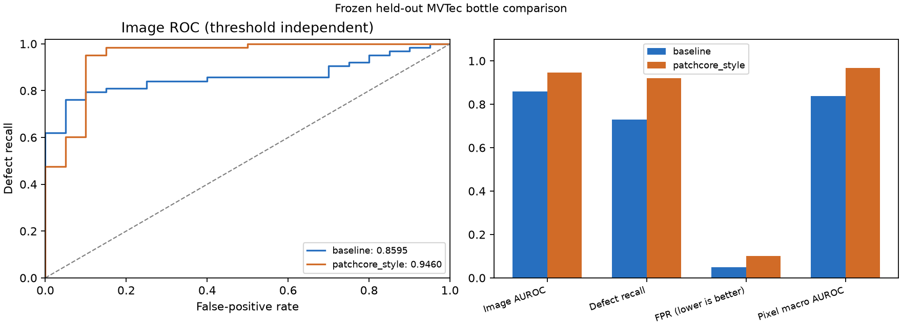
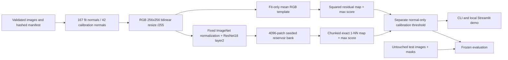
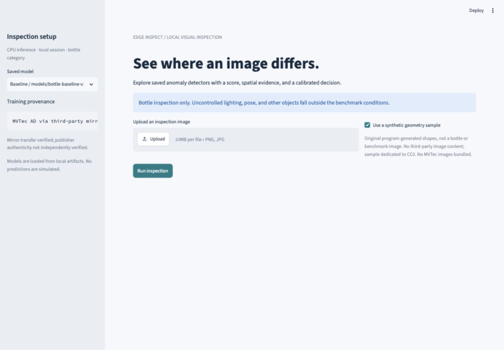
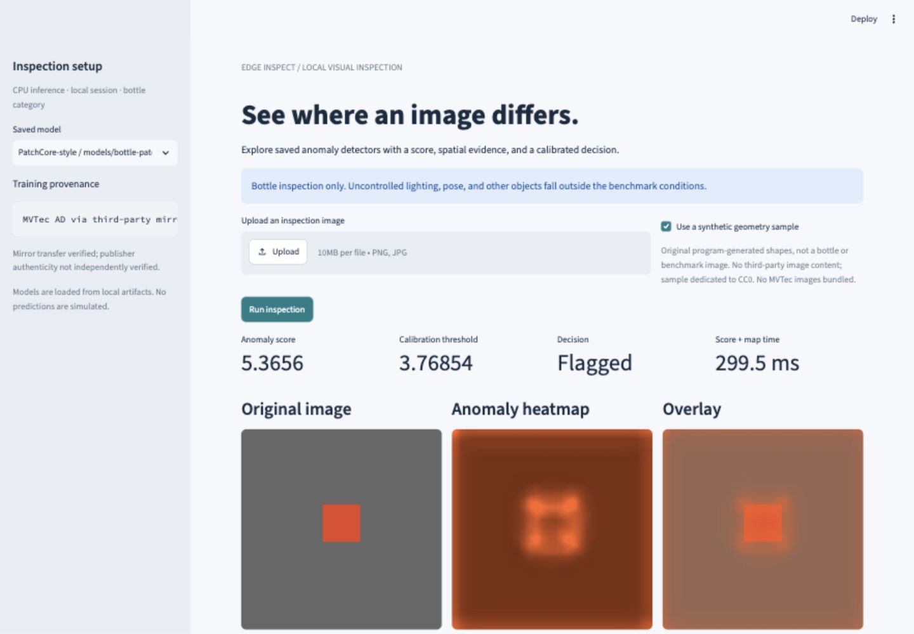

# Edge Inspect

A local visual anomaly-detection project by **Thilanka Thushan**: compare a transparent RGB-template baseline with a compact PatchCore-style detector, explain scores with spatial heatmaps, and measure CPU inference rather than assuming an export makes it faster.

**Portfolio release with real-data evaluation.** The original MVTec AD bottle category was acquired from a pinned third-party mirror after the publisher download failed. Transfer integrity is verified; publisher authenticity is not independently verified. The demo runs **locally**, not on a public service. This is an engineering prototype, not production-validated inspection.

[Results and error analysis](docs/REAL_RESULTS.md) · [Runtime comparison](docs/REAL_ONNX_RESULTS.md) · [Model card](docs/MODEL_CARD.md) · [Case study](docs/CASE_STUDY.md) · [Release checklist](docs/RELEASE.md)

## Measured quality

Frozen settings, 167 normal model-fit images, 42 separate normal calibration images, and 83 held-out test images (63 defective / 20 normal). No test anomalies selected models, preprocessing, thresholds or hyperparameters.

| Model | Image AUROC | Defect recall | Test FPR | TP / FN / FP / TN | Pixel macro AUROC |
|---|---:|---:|---:|---|---:|
| RGB-template baseline | 0.8595 | 73.02% | 5.00% | 46 / 17 / 1 / 19 | 0.8375 |
| PatchCore-style | **0.9460** | **92.06%** | 10.00% | 58 / 5 / 2 / 18 | **0.9679** |

The learned model detects more defects, with more false alarms and much higher inference cost. It is not better on every defect type. The 5% calibration **target** is not a guarantee: only 20 test normals make each false alarm worth five percentage points. Pixel AUROC is an equal-image mean of within-image AUROCs at original mask resolution over 63 anomalous images; 20 normal images are undefined and excluded. **It is not pooled pixel AUROC.**



[Machine-readable metrics, thresholds, artifact hashes and protocol](docs/final_evaluation_status.json). Real-data runtime measurements are separate from quality findings; [historical synthetic-fixture measurements](docs/ONNX_RESULTS.md) remain labeled as software verification. No camera, Raspberry Pi, GPU or other edge-device results are claimed.

## Architecture



The baseline learns only a mean spatial RGB template. The feature detector uses frozen `IMAGENET1K_V1` ResNet18 layer2 features, seed 42, and a bounded 4096×128 float32 memory bank (2 MiB; not total process memory). Calibration images never enter either reference. This is **PatchCore-style**: one compact feature layer and uniform reservoir sampling replace the original multi-layer/coreset design. [Method and limitations](docs/PATCHCORE_STYLE.md).

Only the feature extractor is exported to ONNX. Preprocessing, normalization, patch layout, nearest-neighbor scoring, map resizing and threshold decisions remain explicit external code. CPU is the reliable default.

## Quickstart: no dataset or weights needed

Python 3.11–3.14; native verification uses Python 3.14.0. From a new checkout:

```sh
git clone https://github.com/thilankathushan/edge-inspect.git
cd edge-inspect
python3 -m venv .venv
.venv/bin/python -m pip install -e '.[dev,demo]'
.venv/bin/edge-inspect check-config --config configs/default.toml
.venv/bin/python scripts/verify_fixture_baseline.py --name portfolio-demo
.venv/bin/streamlit run app.py --server.address 127.0.0.1
```

Open http://127.0.0.1:8501. Select the **fixture-trained** baseline, check the synthetic geometry sample, and run inspection. This offline quickstart verifies software, not bottle quality. Choose a new fixture run name if repeating it; outputs are never overwritten. On the author's completed workspace, real bottle-trained models are already available and listed first.

No packages are installed system-wide. For all optional capabilities:

```sh
.venv/bin/python -m pip install -e '.[dev,demo,features,evaluation,onnx]'
.venv/bin/python -m pytest -q
```

Dependency ranges are in `pyproject.toml`; `requirements-*.lock.txt` record tested environments. These are version records, not cross-platform wheel/hash locks. CI tests Python 3.11 and 3.14 without dataset or weight downloads.

## Data and configuration

Read [dataset attribution and terms](docs/ATTRIBUTION.md), [acquisition provenance](docs/DATA_ACQUISITION.md), and [the frozen protocol](docs/DATA_PROTOCOL.md). MVTec data is CC BY-NC-SA 4.0, not covered by this project's MIT license. No dataset photographs, archives, model weights or banks are bundled. Preserve notices; do not infer unrestricted commercial use or redistribution rights.

Expected layout:

```text
data/mvtec_ad/bottle/
  train/good/*.png
  test/good/*.png
  test/<defect>/*.png
  ground_truth/<defect>/*_mask.png
```

`configs/default.toml` controls data/artifact paths, bottle category, seed 42 and CPU. Relative paths resolve against the config file. Unknown keys, overlapping roots, unsafe categories and unsupported devices are rejected.

```sh
.venv/bin/edge-inspect inspect-data --config configs/default.toml
.venv/bin/edge-inspect prepare-data --config configs/default.toml
```

The validator checks corruption, frame count, dimensions, duplicate hashes, mask pairing and binary masks. The manifest records image/mask SHA-256, original dimensions, labels, source split and assigned role. Normal training images are deterministically split by seeded hash ordering: ceil(20% × N) for calibration. Test data is guarded from training and ad-hoc prediction. Normalization is RGB float32 CHW /255; learned features add fixed ImageNet mean/std. Image resizing is direct bilinear 256×256; masks use nearest-neighbor when resized. Raw data stays unchanged.

Commands return JSON results and structured stderr logs; invalid inputs return useful errors. `edge-inspect --help` lists all commands.

## Train and predict

Use the exact manifest printed by `prepare-data`. In the completed local run it is:

```sh
MANIFEST=artifacts/manifests/bottle-e1bbf78c4b1ecd2dbc5f0394877dfc02c753efb31ea5fcdd8b358154e60ff546.json
.venv/bin/edge-inspect train --config configs/default.toml \
  --manifest "$MANIFEST" --run-name bottle-baseline-v1 --data-kind official_mvtec_ad
# Explicit ~45 MB download from the official PyTorch model host; never implicit:
.venv/bin/edge-inspect fetch-weights --config configs/default.toml
.venv/bin/edge-inspect train-features --config configs/default.toml \
  --manifest "$MANIFEST" --weights artifacts/weights/resnet18-f37072fd.pth \
  --run-name bottle-patchcore-v1 --data-kind official_mvtec_ad
.venv/bin/edge-inspect predict --config configs/default.toml \
  --model artifacts/models/bottle-patchcore-v1 \
  --image /absolute/path/to/your-image.png --output-name user-example
```

On a fresh acquisition, substitute its own manifest digest; the acquisition record and software versions affect the manifest bytes. `official_mvtec_ad` identifies the original dataset family, not publisher-authenticated download provenance; the evaluated models retain their mirror acquisition metadata. Use new run names when outputs already exist.

All statistics and the memory bank use model-fit normals only. Thresholds use rank `ceil((n+1)×0.95)` from normal calibration scores and strict `score > threshold`. At n=42 this is rank 41. Fewer than 19 calibration examples yield an unavailable finite threshold. Saved artifacts include preprocessing, provenance, seed, reference arrays/state and calibration evidence. [Baseline details](docs/BASELINE.md).

Pretrained-weight-specific redistribution/commercial rights have not been established. Torchvision's code license does not establish weight rights. Download source weights explicitly for permitted use and keep them outside Git; [source/hash/license record](docs/PATCHCORE_STYLE.md#weight-license-status).

## Reproduce evaluation

[Pre-run record](docs/REAL_EVALUATION_PROTOCOL.md) and [metric definitions](docs/EVALUATION.md) document the freeze. The first real run is complete and preserved; do not repeat it as untouched.

```sh
.venv/bin/edge-inspect evaluate --config configs/default.toml \
  --manifest "$MANIFEST" \
  --baseline artifacts/models/bottle-baseline-v1 \
  --features artifacts/models/bottle-patchcore-v1 \
  --comparison configs/frozen_comparison.json --run-name frozen-bottle-v1
```

The evaluator snapshots configuration, model/manifest hashes, thresholds, versions and hardware before scoring. It saves confusion counts, AUROC, per-defect results, raw scores/maps, plots and representative success/failure overlays. Undefined metrics are null with reasons. A held-out ledger rejects repeated evaluation unless explicitly `--exploratory`; never erase it. Local report: `artifacts/evaluations/frozen-bottle-v1/REPORT.md`. Dataset-derived overlays stay local; the public report contains aggregate plots and textual error analysis.

## Export and benchmark

```sh
.venv/bin/edge-inspect export-onnx --config configs/default.toml \
  --model artifacts/models/bottle-patchcore-v1 --run-name bottle-resnet18-fp32
.venv/bin/edge-inspect benchmark-onnx --config configs/default.toml \
  --manifest "$MANIFEST" --model artifacts/models/bottle-patchcore-v1 \
  --onnx artifacts/exports/bottle-resnet18-fp32 \
  --run-name bottle-normal-calibration --warmup 5 --repeats 5
# Later runtime comparison on the ALREADY EXPOSED test split:
.venv/bin/edge-inspect benchmark-onnx --config configs/default.toml \
  --manifest "$MANIFEST" --model artifacts/models/bottle-patchcore-v1 \
  --onnx artifacts/exports/bottle-resnet18-fp32 \
  --run-name bottle-exposed-test --warmup 5 --repeats 3 \
  --evaluation artifacts/evaluations/frozen-bottle-v1
```

FP32 opset 18: normalized `[1,3,256,256]` → `[1,128,32,32]`. `predict --onnx artifacts/exports/bottle-resnet18-fp32` uses the export with the same bank and threshold. Numerical parity covers embeddings, scores and maps at atol=rtol=1e-4; decision changes are checked separately and reported even if allclose passes. No quantization or threshold adjustment.

The benchmark uses fresh sequential CPU workers, batch one, one thread, five fit-normal warmups, repeated component/end-to-end p50/p95 measurements, stage RSS and process-lifetime high-water RSS. Excludes model loading, hashes, masks, metrics, file output and rendering from inference timing. Disk caches are warm; system load/thermal state are uncontrolled. Memory includes framework/startup and metric overhead, not just model allocation. [Full methodology](docs/ONNX.md) and [actual real-data findings](docs/REAL_ONNX_RESULTS.md).

## Local demo and deployment

```sh
.venv/bin/streamlit run app.py --server.address 127.0.0.1
# Optional container; stop the native server first if using the same port:
docker compose build                         # baseline only
# FEATURES=true docker compose build         # adds CPU feature-model support
docker compose up -d
# http://127.0.0.1:8501
docker compose down
```

[Deployment verification and limits](docs/DEPLOYMENT.md). The demo discovers trusted saved artifacts, prioritizes real-data models, validates PNG/JPEG uploads up to 10 MiB, and displays original/heatmap/overlay, score, threshold, decision and defined single-call timing. Model loading and rendering are outside that timer. Missing models and invalid input produce guidance rather than fabricated predictions. Upload staging is temporary. The app binds locally and has no camera input or public hosting.

Heatmap intensity is distance/residual strength, **not probability** or a calibrated segmentation. Geometry samples are original program-generated CC0 images, visibly labeled as out of category. They illustrate UI behavior, not bottle detection quality. Screenshots/recording use only these permitted pixels; no MVTec photos are published.




[Watch the captured UI walkthrough](docs/screenshots/demo-walkthrough.gif) (20-second silent screenshot sequence, not a continuous video). Follow the [two-minute recording script](docs/DEMO_SCRIPT.md) for optional narration. The public source does not include models; train locally or use the offline fixture quickstart.

## Verification and limits

```sh
.venv/bin/python -m pytest -q
.venv/bin/python -m pip check
.venv/bin/python scripts/audit_release.py
```

Tests cover configuration, corrupt inputs/masks, split leakage, deterministic scores, artifact round trips, known-answer metrics, export/runtime parity and demo states. Optional feature tests use explicitly cached weights, never download. Lightweight GitHub CI runs without them. [Release checklist](docs/RELEASE.md) records exact checks; [PROGRESS.md](PROGRESS.md) retains the dated history.

Remaining limitations: third-party dataset provenance; small single-category evaluation; sensitivity to pose/lighting/background; coarse localization; no production/load/security validation; weight redistribution rights unresolved. Public hosting, camera validation, quantization and other hardware are optional future work, not claims of this release. Code is [MIT licensed](LICENSE); [data/method/weight attribution](docs/ATTRIBUTION.md) remains separate.

On the author's workspace, Edge Inspect is served at http://127.0.0.1:8503 to avoid an existing app on 8501. Use `--server.port 8503` with the native startup command when needed.

For the actual local run described in this repository, the official-download redirect was unavailable, so a pinned third-party mirror was used. It passed mirror hash checks; those checks establish file transfer integrity relative to that mirror, not the publisher's authenticity. The pre-run snapshot identifies the dataset family as MVTec AD for the evaluator's mode guard, while acquisition provenance is carried separately in the manifest and model metadata. See the disclosure above and the archived provenance; do not infer publisher-authenticated “official” data from that software label.
