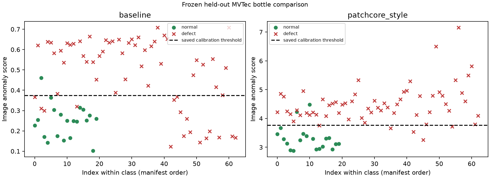

# Frozen bottle evaluation — 2026-10-25

Real MVTec AD bottle images acquired from the pinned **third-party mirror**, not independently authenticated against the publisher archive. See [acquisition](DATA_ACQUISITION.md) and [pre-run freeze](REAL_EVALUATION_PROTOCOL.md). Source data, model states, maps and image overlays remain local and are not redistributed. [Machine-readable results and hashes](final_evaluation_status.json).

167 normal model-fit images; 42 separate normal calibration images; 83 test images. Thresholds were fixed before opening test results. No post-test model changes.

Mode: `official_heldout`. Snapshot recorded before inference: `2026-10-25T03:58:02.029088+00:00`.

No fitting, recalibration, or hyperparameter selection occurred in this evaluation. Later improvements must be reported as exploratory. Scores from this report must not be used to retune and call the same test set untouched.

| Model | Image AUROC | Recall | FPR | TP / FN / FP / TN | Defect / normal n | Pixel macro AUROC (eligible/excluded) |
|---|---:|---:|---:|---|---|---|
| baseline | 0.8595 | 0.7302 | 0.0500 | 46 / 17 / 1 / 19 | 63 / 20 | 0.8375 (63/20) |
| patchcore_style | 0.9460 | 0.9206 | 0.1000 | 58 / 5 / 2 / 18 | 63 / 20 | 0.9679 (63/20) |

PatchCore-style image AUROC exceeds the baseline (difference +0.086508). Recall/FPR and localization are separate outcomes; no post-hoc tuning was performed.

## Pixel aggregation and undefined values

Pixel AUROC is exact per image on original-resolution masks after bilinear map resizing, with ties worth half credit. The reported value is the unweighted mean over images containing both foreground and background. Normal images and all-foreground masks have undefined per-image AUROC and are counted as excluded. This is not pooled/global pixel AUROC and must not be compared directly to pooled benchmark numbers.

All undefined values have null plus an explanation in results.json. Empty class denominators are not reported as zero. No finite calibration threshold means undefined operating decisions/confusion counts, while ranking metrics can still be defined.

## Per-defect results

Each type uses the same normal test images as negatives. Small groups are descriptive, not statistically stable. Per-type AUROC requires at least two samples in each class.

| Model / type | Defect n | TP / FN | Recall | Type-v-normal AUROC | Pixel macro AUROC |
|---|---:|---|---:|---:|---:|
| baseline / broken_large | 20 | 16 / 4 | 0.8000 | 0.9675 | 0.8367 |
| baseline / broken_small | 22 | 22 / 0 | 1.0000 | 0.9932 | 0.8559 |
| baseline / contamination | 21 | 8 / 13 | 0.3810 | 0.6167 | 0.8189 |
| patchcore_style / broken_large | 20 | 19 / 1 | 0.9500 | 0.9375 | 0.9731 |
| patchcore_style / broken_small | 22 | 21 / 1 | 0.9545 | 0.9614 | 0.9929 |
| patchcore_style / contamination | 21 | 18 / 3 | 0.8571 | 0.9381 | 0.9367 |

## Latency

Hardware: `{'os': 'macOS-27.0.1-arm64-arm-64bit-Mach-O', 'architecture': 'arm64', 'python': '3.14.0', 'logical_cpu_count': 8, 'cpu': 'Apple M2', 'memory': '16 GB', 'device': 'cpu', 'cpu_description': 'proc 8:0:4:4'}`.

CPU, 256×256 input, batch size 1, one torch thread, five warmups on a model-fit normal. Each test image is timed once with perf_counter_ns. Model-only includes score/map generation; pipeline timing adds validation, decoding, resize and normalization. Model loading, hashes, masks, original-resolution resize, metrics, plotting and writes are excluded. OS cache state is uncontrolled and files have been read for integrity checking. These are warm-run observations, not cold-start benchmarks. Model order is baseline then PatchCore-style. Small n gives unstable percentiles; no memory benchmark is claimed.

| Model | Timed n | Model-only p50 / p95 ms | Decode+preprocess+model p50 / p95 ms |
|---|---:|---|---|
| baseline | 83 | 0.1596 / 0.2027 | 21.7937 / 23.4181 |
| patchcore_style | 83 | 270.5500 / 297.1225 | 292.2379 / 321.0358 |

## Error analysis and representative examples

The selection rule was fixed before inference: median-score example per outcome bucket, breaking ties by path. All predictions remain available; these examples do not replace the full confusion counts. Ground-truth masks are shown for localization comparison. Observations below describe score/annotation behavior; proposed causes are hypotheses, not established mechanisms.

### baseline

Missed defects: 17; false positives: 1. Threshold: 0.3748110830783844; calibration normals: 42.

**TP: bottle/test/broken_large/008.png** — score 0.594264, saved threshold 0.3748110830783844.
Localization evidence: peak inside annotation=True; mean defect-region score=0.0163; background mean=0.0014; within-image pixel AUROC=0.8644.

Local-only overlay: `artifacts/evaluations/frozen-bottle-v1/baseline/TP_representative.png`.

**FN: bottle/test/contamination/012.png** — score 0.198754, saved threshold 0.3748110830783844.
The annotated defect did not exceed the normal-calibrated image threshold. Small/low-contrast regions can be suppressed by resizing or feature receptive fields; the overlay shows whether the residual is weak or displaced. This explanation is a hypothesis, not a verified cause.
Localization evidence: peak inside annotation=False; mean defect-region score=0.0247; background mean=0.0043; within-image pixel AUROC=0.9493.

Local-only overlay: `artifacts/evaluations/frozen-bottle-v1/baseline/FN_representative.png`.

**FP: bottle/test/good/002.png** — score 0.461357, saved threshold 0.3748110830783844.
A normal-labeled image exceeded the threshold. Appearance variation, alignment, illumination or incomplete normal coverage are possible causes; an image score alone cannot distinguish them.

Local-only overlay: `artifacts/evaluations/frozen-bottle-v1/baseline/FP_representative.png`.

**TN: bottle/test/good/010.png** — score 0.249835, saved threshold 0.3748110830783844.

Local-only overlay: `artifacts/evaluations/frozen-bottle-v1/baseline/TN_representative.png`.

### patchcore_style

Missed defects: 5; false positives: 2. Threshold: 3.768542766571045; calibration normals: 42.

**TP: bottle/test/broken_small/000.png** — score 4.48156, saved threshold 3.768542766571045.
Localization evidence: peak inside annotation=True; mean defect-region score=3.3006; background mean=0.8435; within-image pixel AUROC=0.9972.

Local-only overlay: `artifacts/evaluations/frozen-bottle-v1/patchcore_style/TP_representative.png`.

**FN: bottle/test/broken_small/015.png** — score 3.66332, saved threshold 3.768542766571045.
The annotated defect did not exceed the normal-calibrated image threshold. Small/low-contrast regions can be suppressed by resizing or feature receptive fields; the overlay shows whether the residual is weak or displaced. This explanation is a hypothesis, not a verified cause.
Localization evidence: peak inside annotation=False; mean defect-region score=3.0063; background mean=0.9954; within-image pixel AUROC=0.9948.

Local-only overlay: `artifacts/evaluations/frozen-bottle-v1/patchcore_style/FN_representative.png`.

**FP: bottle/test/good/006.png** — score 4.22824, saved threshold 3.768542766571045.
A normal-labeled image exceeded the threshold. Appearance variation, alignment, illumination or incomplete normal coverage are possible causes; an image score alone cannot distinguish them.

Local-only overlay: `artifacts/evaluations/frozen-bottle-v1/patchcore_style/FP_representative.png`.

**TN: bottle/test/good/003.png** — score 3.13316, saved threshold 3.768542766571045.

Local-only overlay: `artifacts/evaluations/frozen-bottle-v1/patchcore_style/TN_representative.png`.

## Interpretation limits and next steps

The baseline is sensitive to alignment and lighting; its maximum residual can be dominated by noise. The feature detector can miss normal modes through bounded sampling and has coarse receptive-field localization. Both maps are resized, not pixel-calibrated probabilities. Pixel macro AUROC weights eligible images equally and omits one-class masks. Small per-type samples and correlated images limit generalization. No exploratory improvements are included in this report.

Keep this snapshot, manifest, artifacts and results. Any later change informed by these outcomes must be labeled exploratory and needs a new untouched test set for confirmatory claims.

## Visual review and practical tradeoffs

The representative overlays were inspected locally after completion. The baseline contamination miss (`contamination/012.png`) has a broad central annotated region. Its residual map also highlights the rim, and its global maximum lies outside that annotation. The image score (0.1988) stays below 0.3748 despite high within-image pixel ranking (0.9493). Good localization ranking does not ensure a positive image decision.

The feature miss (`broken_small/015.png`) has an annotated chip on the upper-right rim. The broad feature map covers that region, and pixel AUROC is 0.9948, but the image score is 3.6633, below 3.7685. Its maximum falls outside the mask. Coarse receptive fields and bilinear enlargement limit precise boundaries; this observation does not establish why the detector missed it.

The feature false positive (`good/006.png`) is labeled normal. The overlay has a central hotspot as well as widespread bottle response, with score 4.2282. Normal appearance variation or incomplete bank coverage are plausible explanations, not proven causes. Neither the annotation nor threshold was changed.

Most baseline misses are contamination (13/21); the learned model reduces those to 3/21. However, the baseline ranks the two broken-bottle types better and catches all 22 small breaks, while the feature model misses one. The learned model is a better overall ranker here, not universally better. Its 10% observed FPR exceeds the 5% calibration target; 42 calibration normals and only 20 test normals give coarse evidence and no deployment guarantee.

Runtime comparison is reported separately in [REAL_ONNX_RESULTS.md](REAL_ONNX_RESULTS.md). No camera experiments, quantization, robustness guarantee or other-device measurements are included. Future improvements informed by this report must be exploratory and need new held-out data for confirmation.
